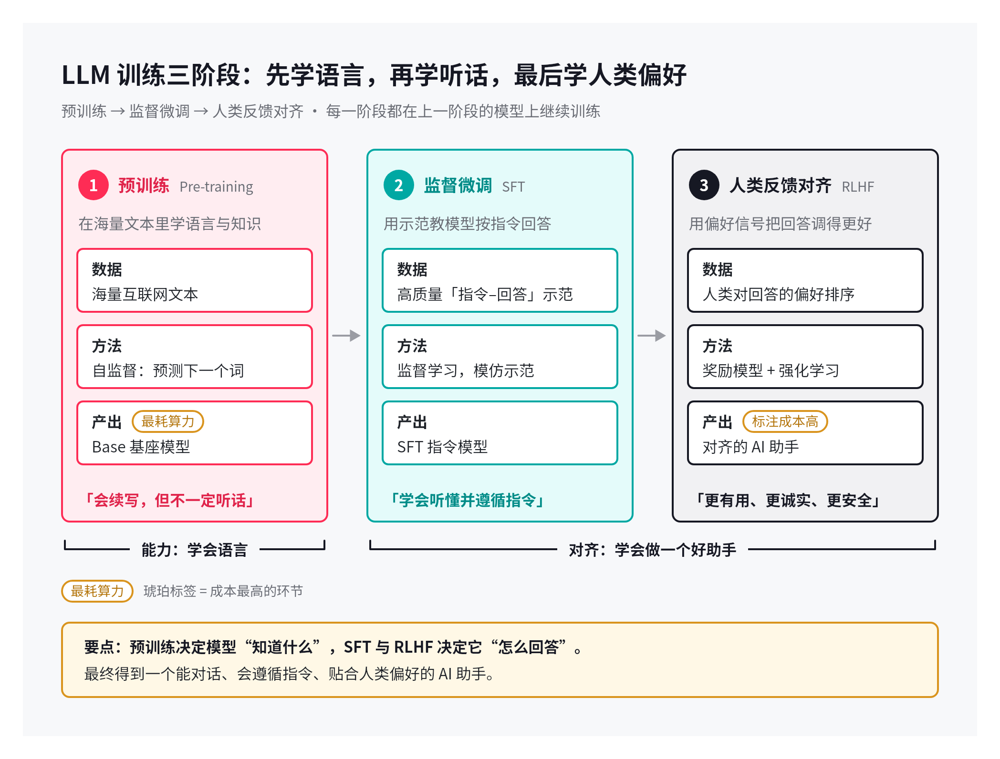
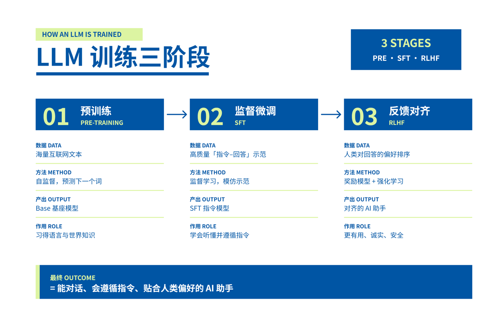
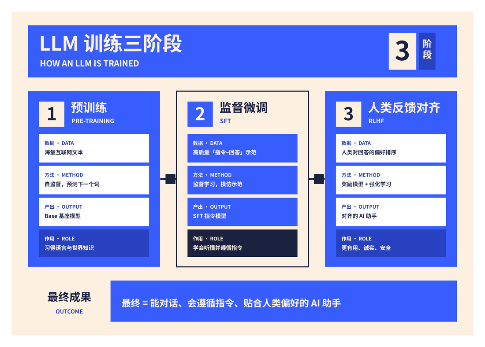

# Minelyf Skills

把好用的方法装进工具箱，让 AI 帮你少做点重复劳动。

持续积累、可独立使用的 AI Skills 合集，从画图开始，逐步扩展到动效短片与更多工作场景。每个 skill 都放在 `skills/` 下独立维护。

## Skills 目录

| 类别 | Skill | 能做什么 | 交付物 | 飞书账号 |
|---|---|---|---|---|
| 视觉表达 | [灵绘出图 · image-linghui](skills/image-linghui/SKILL.md) | 信息图、海报、文档总结图、架构图、流程图，支持参考图重绘和换风格 | 本地 PNG + SVG 源文件 | 不需要 |
| 视觉表达 | [飞书灵绘 · feishu-linghui](skills/feishu-linghui/SKILL.md) | 飞书原生画板、局部改字、加行，以及保留文档评论的操作指引 | 飞书文档内可编辑画板 + 预览图 | 需要登录及编辑权限 |
| 动效视频 | [Canvas 动效短片 · canvas-motion-video](skills/canvas-motion-video/SKILL.md) | 15–60 秒产品宣传或技术讲解短片，文字清晰、可复现、可反复改版 | 本地 MP4 + HTML 源文件 | 不需要 |

两种画图方式各有 36 套配色与版式，按最终交付需求选择。后续新增能力直接加入目录，无需另建仓库。

## 画图怎么选

**直接出图：** 适合下载、发消息、插入报告或做海报。使用「灵绘出图」，不需要飞书账号。默认用 SVG 精确排版，再渲染成 PNG；具体渲染器由运行环境提供。

> 使用 image-linghui，把这段内容做成一张清晰的信息图，交付 PNG 和 SVG。

**结合飞书：** 适合在飞书文档里继续编辑文字、卡片和连线。使用「飞书灵绘」，需要已登录的 `lark-cli` 及目标文档的访问与编辑权限。

> 使用 feishu-linghui，把这段内容整理到飞书文档中，生成可编辑画板。

> 使用 feishu-linghui，把已有画板里的这段文字改掉，保留原来的布局。

## 短片怎么做

适合 15–60 秒、改一句文案就能重渲的产品介绍或技术讲解。使用「Canvas 动效短片」，不需要飞书账号。画面用 HTML Canvas 按帧号绘制，浏览器逐帧截图后合成，配乐由代码生成。

> 使用 canvas-motion-video，把这段内容做成一支文字清晰的动效短片，交付 MP4。

示例抽帧（虚构的 BotMux 演示，不代表每次运行的固定产物）：


## 安装

每个 skill 都以 `SKILL.md` 为入口，附带所需脚本和资源。使用时将完整目录放入所用 AI 工具的 skills 目录，或让支持读取本地文件、执行脚本的助手读取入口；加载方式和调用语法按所用工具配置。`agents/openai.yaml` 是可选的界面元数据，核心指引在 `SKILL.md` 中。

先克隆仓库：

```bash
git clone https://github.com/Minelyf/Minelyf-Skills.git
cd Minelyf-Skills
```

按需选择 `skills/image-linghui`、`skills/feishu-linghui` 或 `skills/canvas-motion-video`，也可同时使用。

下面以 Codex 的默认目录为安装示例：


```bash
mkdir -p ~/.codex/skills
cp -R skills/image-linghui ~/.codex/skills/
cp -R skills/feishu-linghui ~/.codex/skills/
cp -R skills/canvas-motion-video ~/.codex/skills/
```

Codex 用户如果自定义了 `CODEX_HOME`，请复制到该目录的 `skills/` 下；其他工具使用各自的加载目录。已有同名目录时先备份再更新。旧版 `feishu-board`、`beautiful-image-diagram`、`beautiful-feishu-whiteboard` 与这里的能力重叠，建议只启用所选版本，避免重复匹配。

- 灵绘出图：需要可用的 SVG → PNG 渲染工具（例如 CairoSVG、resvg 或浏览器），以及中文字体；Python 示例需要 Python 3。
- 飞书灵绘：需要 Python 3、Node.js/npx 和已登录的 `lark-cli`；SVG 转换工具由 npx 按脚本指定的版本范围下载。
- Canvas 动效短片：需要 Node.js、Playwright（Chromium）、ffmpeg、Python 3 与 numpy，以及中文字体（如 `fonts-noto-cjk`）。把构建脚本放到 `index.html` 同目录或它下面的 `scripts/`，把 `audio/` 放到 `index.html` 同级，再执行 `build.sh`。
- 安装本身不配置账号或导入凭据；飞书登录由使用者在本机完成。

## 风格预览

两种模式使用相同的 36 套风格资源。下方展示其中三套；完整索引见 [出图风格目录](skills/image-linghui/CATALOG.md) 和 [飞书风格目录](skills/feishu-linghui/CATALOG.md)。

| Insight Brief | Avocado Press | Riptide Cobalt |
|---|---|---|
|  |  |  |

预览为通用主题的风格样张，不代表真实业务数据或每次运行的固定产物。

## 仓库结构与扩展

```text
Minelyf-Skills/
├── README.md                 # 全部 skills 的目录与安装入口
├── CONTRIBUTING.md           # 新增、维护和发布约定
└── skills/
    ├── image-linghui/         # 灵绘出图
    ├── feishu-linghui/        # 飞书灵绘
    ├── canvas-motion-video/   # Canvas 动效短片
    └── <next-skill>/          # 后续独立能力
```

新增 skill 时创建独立目录，提供 `SKILL.md`，按需要添加脚本、参考资料和资源，再更新首页目录。具体约定见 [CONTRIBUTING.md](CONTRIBUTING.md)。

## 隐私与来源

仓库仅收录可公开分享的指引、脚本、通用示例和风格资源。请勿提交凭据、画板 token、内部文档链接、个人路径、真实业务数据或工作导出文件。账号与登录状态由各自本机工具管理。

36 套风格模板、样张及相关示例沿用原有 MIT 授权，版权为 Zara Zhang（@zarazhangrui），并经过本地使用方式适配。完整授权保留在各 skill 的 LICENSE 中：[灵绘出图](skills/image-linghui/LICENSE)、[飞书灵绘](skills/feishu-linghui/LICENSE)、[Canvas 动效短片](skills/canvas-motion-video/LICENSE)。新增资源需单独确认来源与授权。
